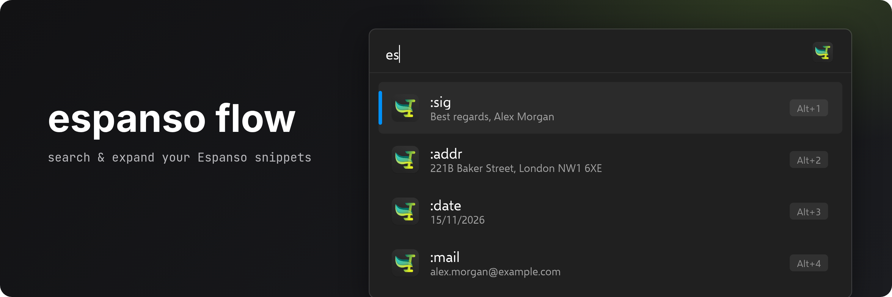

<!-- generated by readwright from docs/README.md.j2; edit the template, not this file -->


# Espanso Flow

Search your Espanso snippets from Flow Launcher and expand them where you were typing.

[](https://github.com/Garulf/Espanso-Flow/actions/workflows/tests.yml) [](https://github.com/Garulf/Espanso-Flow/releases/latest) [](https://github.com/Garulf/Espanso-Flow/releases/latest)

[](https://www.buymeacoffee.com/garulf) [](https://github.com/sponsors/Garulf)

## Features

* **Every snippet in one place.** Lists the matches from your own files and from installed packages.
* **Search by trigger or text.** `es regards` finds `:sig` even if you forgot the trigger.
* **Expands where you were typing.** Pick a snippet and Espanso types it into the window you came from.
* **Live dates.** Date snippets show today's date in the preview.
* **Zero configuration.** Finds Espanso and its config folder on its own. For a portable install, point the setting at its `espanso.cmd`.

## Usage

Type `es` to list your snippets, or add some text to search them:

```
es regards
```


Press `Enter` on a result. Flow Launcher closes and Espanso expands the snippet in the window that was
focused before.


Snippets are read from Espanso's `match` folder the same way Espanso reads them: every `.yml` file in it
and its subfolders, including packages, except files whose name starts with `_`. Older configs with a
`default.yml` and a `user` folder work too. Regex matches have no trigger to expand, so they are not listed.

## Installation

Download `Espanso-Flow-<version>.zip` from the [latest release](https://github.com/Garulf/Espanso-Flow/releases/latest) and unzip it into
`%appdata%\FlowLauncher\Plugins`, then restart Flow Launcher.

Pre-releases of the next version are published from the open release PR on the
[releases page](https://github.com/Garulf/Espanso-Flow/releases) for testing. Flow Launcher won't offer them as updates.

## Configuration

Open **Settings → Plugins → Espanso Flow** in Flow Launcher:

| Setting | Default | Description |
| --- | --- | --- |
| Espanso PATH | | Path to `espanso.cmd`. When blank, `%LOCALAPPDATA%\Programs\Espanso\espanso.cmd` is used |

## Requirements

* [Espanso](https://espanso.org) 2.x, running
* Flow Launcher 1.17.0 or newer
* Python 3.8 or newer, which Flow Launcher can install for you

## Changelog

### [0.0.1](https://github.com/Garulf/Espanso-Flow/releases/tag/v0.0.1) - 2022-03-28

- First release: search your Espanso snippets and expand them from Flow Launcher.

See [CHANGELOG.md](CHANGELOG.md) for the full history.
